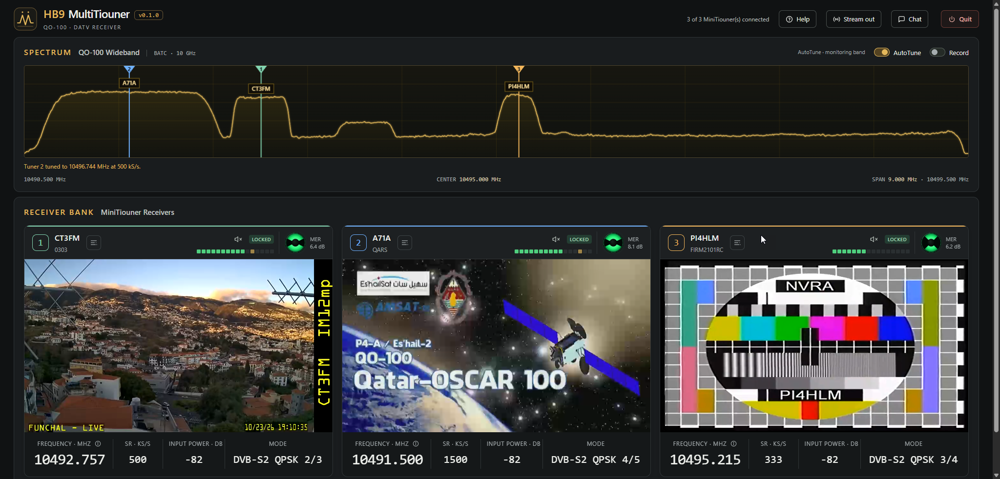

# HB9 MultiTiouner

**Receive QO-100 DATV with several MiniTiouners (and, experimentally, PicoTuners) at once, in your web browser.**



> ### PicoTuner support: NOT tested on real hardware
> | | Status |
> |---|---|
> | **MiniTiouner** (MiniTiouner, Express, Pro) | Supported, tested with real hardware |
> | **PicoTuner** | **Experimental. Never tested with a real PicoTuner.** |
>
> HB9 MultiTiouner can also use PicoTuners: both tuners of each one, and several PicoTuners at the same time. **It should normally work, but I cannot promise it.** I do not have a PicoTuner and I do not know anybody who could test it for me, so I could only try it with **emulators** (Raspberry Pi Pico boards that pretend to be a PicoTuner).
>
> - **Tested with the emulators:** finding the PicoTuner, tuning, lock, video, both tuners at the same time, two PicoTuners at the same time, unplugging and plugging in again.
> - **Not tested, because an emulator cannot show it:** reception of a real signal, LNB power and the 22 kHz tone, how a real PicoTuner behaves on USB at full data rate, and anything specific to a particular PicoTuner version.
>
> **If you own a PicoTuner, please try it and tell me how it went, good or bad. Your feedback is very welcome and it is the only way I can make this work properly.** Please open an issue on GitHub or write to me at the e-mail address on my [QRZ.com page](https://www.qrz.com/db/HB9IIU). The file `HB9-MultiTiouner.log` next to the program helps a lot, please attach it.
>
> To use a PicoTuner, its two USB interfaces ("PicoTuner i2c" and "PicoTuner TS") must be bound to the WinUSB driver (for example with Zadig). Only one program can use a PicoTuner at a time, so close OpenTuner first.

## Why this exists

HB9 MultiTiouner grew out of my project [SDR-Tiouner](https://github.com/HB9IIU/SDR-Tiouner). Radio amateurs who own **several MiniTiouners but no wideband SDR radio** asked me for the same, or a similar, web experience. This is it: one page that shows the QO-100 wideband spectrum, receives with all your MiniTiouners at the same time, and shows every picture in your browser.

It is made by an amateur for amateurs, as a hobby. It is **free of charge and not for sale**. If anyone asks you to pay for it, please do not, and let me know.

## What it does

- Finds every connected MiniTiouner (and, experimentally, PicoTuner) and numbers them. The numbers are remembered by USB serial number. A PicoTuner has none, so it is remembered by the USB port it is plugged into.
- Shows the QO-100 wideband spectrum (the BATC feed) with a marker for each tuner.
- **LNB setting:** for LNBs that are not 9750 MHz, type your LNB frequency in the **Settings** window. It is applied at once and remembered.
- **Calibration:** every LNB and tuner has a small frequency error. One button measures it on the beacon, separately for each tuner, and corrects it.
- **Click a signal** in the spectrum, or drag a numbered marker, to tune a tuner.
- **AutoTune** gives the stations it finds to free tuners by itself. The beacon (10491.500 MHz) only gets a tuner when one is spare.
- Shows the pictures in the browser, with sound per tuner and a small audio level meter.
- **Stream out:** sends each tuner's video to VLC, OBS or another PC on your home network (UDP multicast).
- **Record:** saves every transmission, except the beacon, into a `Recordings` folder, one folder per callsign.
- **Transport stream info:** a card per tuner with the service name, PIDs, bitrates, codec, picture size and error counters.
- Signal details per tuner: carrier frequency, offset, MER, input power, mode.
- Reads the BATC wideband chat, and lets you write to it.
- A **Help** window with a short how-to, the credits and the licence.
- Tells you when a new version has been released on GitHub (it can be switched off).

## What you need

- Windows 10 or 11, 64 bit
- one or more **MiniTiouner** (MiniTiouner, Express or Pro), or a **PicoTuner** (experimental, see the note at the top)
- the **FTDI D2XX driver** (the one your MiniTiouner needs anyway). A PicoTuner needs the WinUSB driver instead (see the note at the top)
- a modern browser (Edge, Chrome, Firefox)
- an internet connection, for the BATC spectrum and chat

## Quick start

1. Download the zip from the [Releases](../../releases) page and unzip it anywhere. It is portable: everything stays in that one folder.
2. Connect your MiniTiouner(s) or PicoTuner(s) and close any other program that uses them (OpenTuner, the MiniTiouner app).
3. Start `HB9-MultiTiouner.exe`. Your browser opens at `http://127.0.0.1:47322`.
4. Check the list of detected tuners. It starts by itself after three seconds, or press **Start receiving**.

The page is only reachable from your own PC. There is a small icon in the system tray to open the page again or to quit.

## Stream out to VLC or OBS

Press **Stream out** in the header. Each tuner gets its own address, for example `udp://@239.255.0.1:1234`. Copy it into VLC (*Media > Open Network Stream*), or the OBS line into an OBS *Media Source* (untick *Local File*). Any PC on your home network can open the same address.

If OBS stays black on another computer (a Mac, for example), type that computer's address into the field in the panel and copy the address again. If nothing arrives, allow the program through the Windows firewall for private networks.

## Recording

The **Record** switch next to AutoTune is always **off** when the program starts. When it is on, every transmission that a tuner is locked on is saved, except the beacon:

```
Recordings\DK0TE\2026-10-23_18-45-12.ts
```

The callsign is taken from the service name of the station. If there is none, the folder is called `NOCALLSIGN`. Recordings shorter than 10 seconds are deleted. The files are raw transport streams, so VLC plays them directly.

## Optional settings

**LNB frequency:** press **Settings** in the header and type the frequency printed on your LNB (many use 9750 MHz). It is applied at once to all tuners and remembered. The window tells you if the value cannot work with the QO-100 band.

**Calibration:** in the same window, **Calibrate with the beacon** measures the frequency error of each tuner. Every tuner is tuned away and back to the beacon (10491.500 MHz) four times, and the readings are averaged. The correction is saved for each tuner (by its USB serial number) and added to every frequency it receives. Press *Start receiving* first. It takes about a minute, the tuners go back to what they were doing afterwards, and AutoTune and recording pause meanwhile. Run it again whenever the LNB has changed or is warming up. A correction that is clearly too large, or readings that disagree, are refused with a message.

**Updates:** a little after it starts, and then once a day, the program asks GitHub whether a newer version has been released. If so, a bar appears under the header with a link to the download page; "Later" hides it for that version. Only the list of versions of this program is asked for, and nothing about you or your radio is sent. You can switch the check off in **Settings**.

Copy `player.example.json` to `player.json` next to the program to change the RF input, the LNB power or the 22 kHz tone. Without that file the defaults are used.

The program creates a few small files next to itself: `settings.json`, `tuner-numbers.json`, `autotune.json`, `streamout.json`, `Recordings\` and log files.

## Build it yourself

You need the .NET SDK and the .NET Framework 4.7.2 targeting pack.

```powershell
dotnet build .\HB9-MultiTiouner.csproj -c Release
```

The video of each tuner goes through FFmpeg and MediaMTX, which are not stored in this repository. Put `ffmpeg.exe` and `mediamtx.exe` into `tools\ffmpeg\` and `tools\mediamtx\` (the release zip already contains them). See [NOTICE.md](NOTICE.md) for versions and sources.

`tests\Check-AutoTune.ps1` (PowerShell 7) checks the AutoTune decisions.

## Credits and licence

Thank you to Michel, HB9DUG, whose encouragement got me started on this version.

HB9 MultiTiouner is free software under the **GNU General Public License v3.0** (see [LICENSE](LICENSE)).

The tuner code comes from [Open Tuner](https://github.com/tomvdb/open_tuner) by Tom ZR6TG and contributors, through the QOCAST Player. Thanks also to BATC for the wideband spectrum feed and chat, and to the authors of FFmpeg and MediaMTX. All third-party parts are listed in [NOTICE.md](NOTICE.md).

## Contact

Open an issue on GitHub, or write to me at the e-mail address on my [QRZ.com page](https://www.qrz.com/db/HB9IIU).

73, **HB9IIU**
